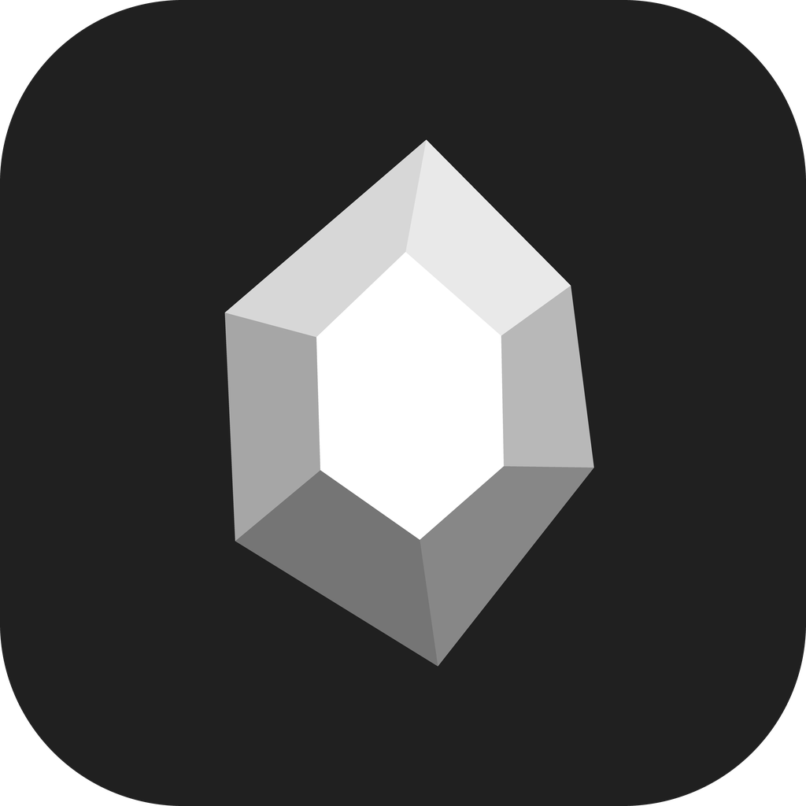

<p align="center">
  
</p>

<h1 align="center">Silex</h1>

<p align="center">
  Editor de notas em Markdown, rápido e leve.<br />
  Núcleo em Rust, interface minimalista e IA integrada.
</p>

---

O Silex trabalha direto numa pasta de arquivos `.md` (o "cofre"): suas notas continuam sendo arquivos de texto comuns, legíveis por qualquer editor, sincronizáveis por OneDrive, Git ou o que preferir. Não há banco de dados proprietário nem conta.

Tudo que é pesado (índice, busca, renderização de blocos, exportação, IA) roda em **Rust**. A interface é uma camada fina sobre o WebView do sistema, sem Electron, o que mantém o consumo de memória baixo.

## Desempenho

Abrindo o mesmo cofre (909 notas) na mesma máquina, com o app parado: **244 MB de memória privada no Silex contra 612 MB num editor de notas em Electron**, 60% a menos (mediana de 3 rodadas, somando todos os processos de cada app). Metodologia, premissas, limitações e dados brutos em [docs/benchmark](docs/benchmark/README.md).

## Recursos

**Editor**
- Visualização ao vivo: a marcação some onde o cursor não está (títulos, negrito, links, imagens, callouts) e volta ao editar
- Modo fonte (Markdown cru) com `Ctrl+E`
- `[[links entre notas]]` e `![[embeds]]` com sugestões enquanto você digita
- Tabelas interativas: edite células no lugar, `Tab`/`Enter` para navegar, menu para inserir, mover, alinhar e excluir linhas e colunas
- Tarefas com vários status (`- [ ]`, `- [x]`, `- [/]`, `- [-]`…), `Ctrl+L` para criar ou alternar
- Barra de formatação flutuante e responsiva
- Mover linhas com `Ctrl+Shift+↑/↓`, colar imagens (viram anexos), colar células do Excel (viram tabela)
- Propriedades (front matter YAML) editáveis num painel

**Cofre**
- Árvore de arquivos com arrastar e soltar e "Mover para…"
- Busca de texto completo (Tantivy) com frases, proximidade, `OR`, exclusão e `title:`
- Grafo de notas, abas com histórico (fixe abas e elas voltam ao reabrir o app), paleta de comandos (`Ctrl+P`) e troca rápida de arquivo (`Ctrl+O`)
- Atalhos configuráveis: qualquer comando da paleta pode ganhar um atalho (Configurações › Atalhos)
- Visualizadores de PDF, imagem, vídeo, áudio e planilhas; quadros Canvas e desenhos Excalidraw

**Plugins nativos** (em Rust, ligados e desligados nas configurações)
- **rustview:** blocos de script na nota sobre o índice de páginas ([docs/rustview.md](docs/rustview.md))
- **Templater:** templates com prompts e variáveis
- **Numerals:** blocos de cálculo
- **Exportar:** PDF, HTML e Word (`.docx`) sem dependências; outros formatos via Pandoc, se instalado
- **Chat de IA:** veja abaixo

**Plugins de terceiros** em WebAssembly, isolados (sem acesso a disco ou rede): [docs/plugins.md](docs/plugins.md)

**Aparência:** modos escuro e claro (ou o do sistema), minimalistas e monocromáticos, além de temas e snippets CSS.

## Chat de IA

Janela flutuante ou painel lateral (`Ctrl+J`), com várias conversas salvas.

| Provedor | Como funciona |
| --- | --- |
| Claude Code | CLI instalado na máquina, usando o login dele |
| Codex | CLI instalado na máquina, usando o login dele |
| Anthropic | API, com streaming |
| OpenAI | API, com streaming |
| Gemini | API, com streaming |

- Os CLIs rodam com o cofre como pasta de trabalho e podem ler suas notas; o nível de permissão (só leitura, editar, total) é escolhido no chat, e pedidos bloqueados podem ser liberados na hora
- Cite notas com `[[`; anexe imagens, PDFs, planilhas, documentos e textos (botão, colar ou arrastar). Os anexos ficam organizados em `ai/anexos/AAAA-MM/` no cofre
- Mostra o raciocínio do modelo, as ferramentas usadas e os tokens consumidos
- Fechar o painel não interrompe a resposta: ela continua em segundo plano

As chaves de API ficam no cofre de credenciais do sistema (Gerenciador de Credenciais do Windows, Keychain, Secret Service) e nunca passam pela interface.

## Instalação

Baixe o instalador na página de [Releases](../../releases) (`-setup.exe` para Windows).

### Atualizações

Cada push na `main` gera uma Release (`.github/workflows/release.yml`), numerada como `0.1.<execução>`. O Silex instalado consulta a última Release ao abrir (e a cada 6 h) e mostra um aviso **Atualizar e reiniciar**; também dá para verificar pela paleta (`Verificar atualizações do Silex`). Pushes que só mudam documentação não geram versão.

As atualizações são assinadas. A chave pública está em `src-tauri/tauri.conf.json`; a privada fica fora do repositório, no secret `TAURI_SIGNING_PRIVATE_KEY` do GitHub (a chave não tem senha). Para gerar um instalador localmente com `pnpm tauri build`, defina `TAURI_SIGNING_PRIVATE_KEY` (conteúdo ou caminho da chave) e `TAURI_SIGNING_PRIVATE_KEY_PASSWORD` vazio.

## Desenvolvimento

Pré-requisitos:
- [Node.js](https://nodejs.org) 20+ e [pnpm](https://pnpm.io)
- [Rust](https://rustup.rs) estável
- Windows: WebView2 (já vem no Windows 10/11). Outros sistemas: veja os [pré-requisitos do Tauri](https://tauri.app/start/prerequisites/)

```sh
pnpm install
pnpm tauri dev      # app em modo de desenvolvimento
pnpm tauri build    # executável e instaladores em src-tauri/target/release
pnpm check          # verificação de tipos do frontend
cd src-tauri && cargo test
```

### Estrutura

```
src/                 interface (Svelte 5 + CodeMirror 6)
  lib/editor/        visualização ao vivo, tabelas, comandos do editor
  lib/plugins/       telas dos plugins nativos (chat, mesa, ...)
  styles/            sistema visual (tokens --sx-*)
src-tauri/src/       núcleo em Rust
  lib.rs             cofre, arquivos, índice
  search.rs          busca (Tantivy)
  rustview.rs        blocos de script (Rhai)
  chat.rs            chat de IA (APIs e CLIs)
  export.rs          PDF/HTML/DOCX
  plugins.rs         host de plugins WebAssembly (wasmi)
plugins/             SDK e exemplo de plugin WebAssembly
scripts/             utilitários (ícones, fontes do Excalidraw)
```

A logo é gerada por `scripts/make-icons.py` a partir de `src/lib/logo.ts`.

## Stack

[Tauri 2](https://tauri.app) · [Rust](https://www.rust-lang.org) · [Svelte 5](https://svelte.dev) · [CodeMirror 6](https://codemirror.net) · [Tantivy](https://github.com/quickwit-oss/tantivy) · [Rhai](https://rhai.rs) · [wasmi](https://github.com/wasmi-labs/wasmi) · [Excalidraw](https://excalidraw.com) · [pdf.js](https://mozilla.github.io/pdf.js/)

## Licença

[PolyForm Noncommercial 1.0.0](LICENSE). Você pode usar, estudar, modificar e compartilhar o Silex livremente para fins **não comerciais** (uso pessoal, estudo, pesquisa, organizações sem fins lucrativos). Uso comercial não é permitido sem autorização do autor.

Copyright (c) 2026 Bryan Zucolotto Borges
