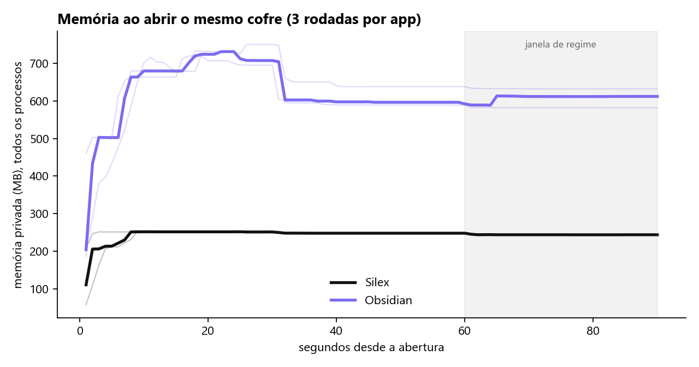
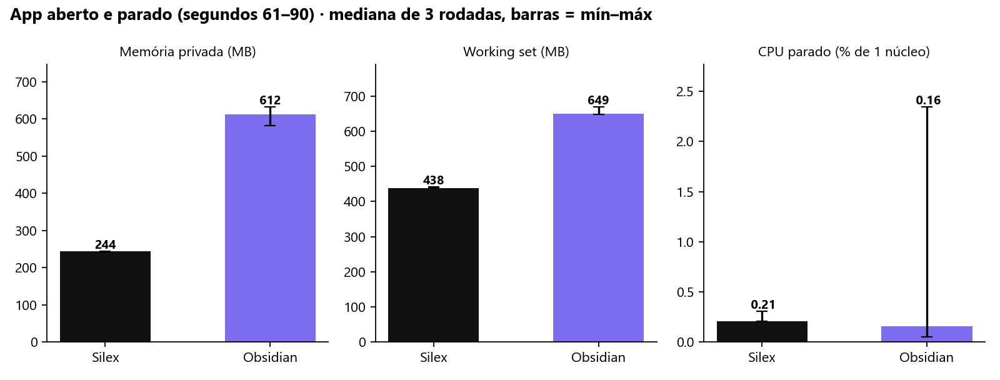

# Silex vs. Obsidian: memória e CPU ao abrir o mesmo cofre

Medição feita em 16/10/2026. Dados brutos em [`dados-2026-10-16.csv`](dados-2026-10-16.csv) (540 amostras), resumo em [`resumo.json`](resumo.json).

## Resultado

App aberto e parado (segundos 61 a 90 após abrir). Mediana de 3 rodadas, com mínimo e máximo entre parênteses.

| | Silex 0.1.0 | Obsidian 1.14.4 | Diferença |
| --- | --- | --- | --- |
| Memória privada | **244 MB** (243–244) | **612 MB** (582–632) | Silex usa 60% menos (2,5×) |
| Working set | 438 MB (438–441) | 649 MB (649–669) | Silex usa 32% menos |
| Pico de memória privada (0–90 s) | 253 MB (251–253) | 733 MB (720–751) | Silex usa 66% menos |
| CPU parado (% de 1 núcleo) | 0,21% (0,21–0,31) | 0,16% (0,05–2,34) | Empate técnico |
| CPU gasta até 60 s | 21,0 s (5,7–36,2) | 10,5 s (8,1–26,3) | Inconclusivo (dispersão alta) |
| Processos | 7 | 4 | n/a |

## Como foi medido

- **Mesma máquina e mesmo cofre:** Intel Core i7-11390H (8 threads), 15,7 GB de RAM, Windows 11 Pro (build 26200), WebView2 155. Cofre com 909 notas, 2.030 arquivos e 80 MB, numa pasta do OneDrive.
- **Abertura a frio:** cada rodada abre o app, amostra a cada 1 s durante 90 s e fecha; depois espera 20 s. São 3 rodadas por app, com ordem alternada a cada rodada (O-S, S-O, O-S) para não favorecer quem roda primeiro.
- **Todos os processos do app:** soma da árvore de processos inteira (o Silex com o WebView2, o Obsidian com os processos do Electron). Medir só o processo principal subestimaria os dois.
- **Métricas:**
  - **Memória privada** (`PrivateMemorySize64`): memória que só o app usa. É a métrica principal.
  - **Working set**: inclui páginas compartilhadas com o sistema, como as DLLs do runtime.
  - **CPU**: tempo de CPU somado dos processos.
- **Script:** [`scripts/benchmark-memoria.ps1`](../../scripts/benchmark-memoria.ps1) mede; [`scripts/benchmark-graficos.py`](../../scripts/benchmark-graficos.py) resume e gera os gráficos. Nenhum número foi digitado à mão.

## Premissas e limitações

- **Configuração real de uso, sem ajustes:**
  - Obsidian com os 9 plugins de comunidade que estavam ativos.
  - Silex com os 10 plugins nativos ativos e nenhum plugin WebAssembly.
- **Estado inicial diferente:** o Obsidian reabre a área de trabalho salva (uma tela de plugin, a Mesa, mais o explorador de arquivos); o Silex abre com uma aba vazia. Isso pode favorecer o Silex, mas o tamanho do efeito não foi medido.
- **Cenário único:** só abertura e app parado. Edição, busca, várias abas e grafo não foram medidos.
- **Amostra pequena:** 3 rodadas por app, sem controle dos outros programas em segundo plano (OneDrive ligado).
- **CPU de abertura:** variou muito nos dois apps, então não permite conclusão. O Silex reconstrói o índice de busca de texto completo a cada abertura, o que pesa nessa métrica. A soma conta só os processos vivos no momento de cada amostra.
- **Sem valor estatístico formal:** é uma comparação de engenharia, reproduzível com os scripts acima.
